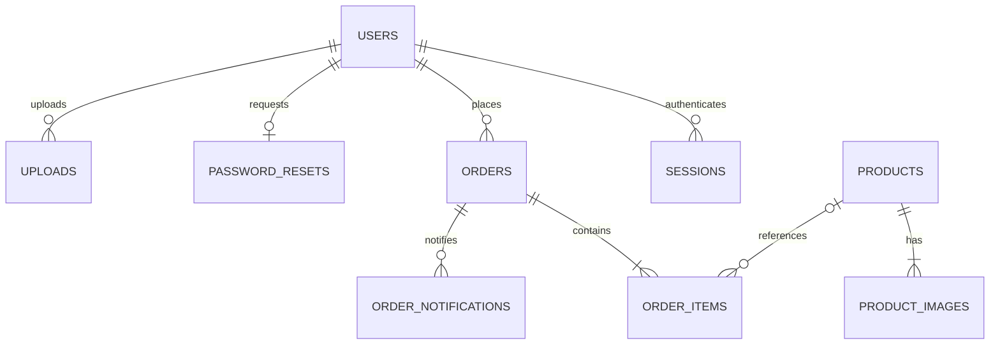

# Thiết kế MySQL

Schema thực thi: `backend/database/schema.sql`. MySQL 8.4, InnoDB, utf8mb4; thời gian lưu UTC và hiển thị theo locale người dùng.

| Bảng | Trường và ý nghĩa chính |
| --- | --- |
| users | id PK; email UNIQUE; password_hash; name; role user/admin; created_at |
| sessions | token_hash PK; user_id FK, cho phép NULL với phiên biểu mẫu; csrf_token; expires_at |
| products | id PK; name; description; description_html; price/original_price; category; subcategory; sizes/colors JSON; flags; stock_quantity; version; timestamps |
| product_images | id PK; product_id FK CASCADE; url; position |
| orders | id PK; user_id FK; thông tin giao hàng và payment_instructions JSON snapshot; total; shipping_fee; status; payment_method; payment_status; khiếu nại/xác nhận; version; created_at |
| order_items | id PK; order_id FK CASCADE; product_id FK SET NULL; tên/ảnh/giá snapshot; quantity; size; color |
| password_resets | user_id PK/FK; code_hash; attempts; expires_at |
| uploads | id PK; user_id FK; filename UNIQUE; mime_type; created_at |
| rate_limits | key_hash PK; attempts; expires_at; không lưu IP rõ |
| newsletter_subscribers | email PK; created_at |
| audit_logs | id PK; user_id; action; entity_id; created_at |
| app_metadata | name PK; value; marker khởi tạo để không tự seed lại khi xóa hết sản phẩm |
| app_settings | name PK; value; updated_at; cấu hình ngân hàng/SMTP, mật khẩu SMTP mã hóa AES-256-GCM |
| order_notifications | id PK; order_id FK CASCADE; recipient; subject; html; message; status sent/preview/failed; transport; created_at DATETIME(6); sent_at |

Giá tiền dùng số nguyên VND (`BIGINT UNSIGNED`), tránh sai số floating point. sizes/colors là dữ liệu biến thể đơn giản của sản phẩm; ảnh và item tách bảng để quản lý quan hệ và giữ lịch sử. Tồn kho hiện quản lý theo sản phẩm, không tách từng size/màu.

Khóa ngoại users/orders và orders/items bảo đảm không có item mồ côi. Index cho email, danh mục/trạng thái sản phẩm, giá, user/date và status/date đơn hàng. `version` tăng sau cập nhật để trả 409 khi form dùng dữ liệu cũ.

Khởi tạo một lần bằng `backend/database/init.php`; chạy lại không ghi đè dữ liệu. Cài mới chỉ tạo sản phẩm và tài khoản demo sạch. Mã nhập JSON của phiên bản cũ đã được loại bỏ sau khi hoàn tất chuyển dữ liệu sang MySQL.

Tài khoản ứng dụng chỉ được cấp quyền trên database được cấu hình; không dùng root để chạy API. Windows dùng tài khoản root riêng chỉ cho bước tạo database và bộ kiểm thử tách biệt.
