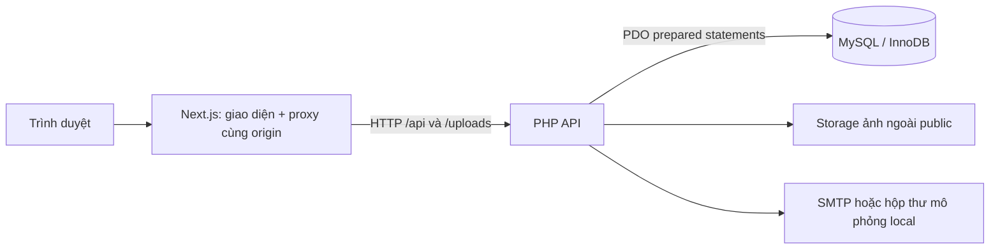

# Website Nike Store — Phân tích và thiết kế

## Mục tiêu và phạm vi

Xây dựng website bán hàng cơ bản theo đề môn Lập trình Web. Khách xem, tìm kiếm và lọc sản phẩm; đăng ký, đăng nhập, đặt hàng, theo dõi và hủy đơn đúng điều kiện. Quản trị viên quản lý nội dung sản phẩm, ảnh, tồn kho, đơn hàng và xác nhận tiền đã thu.

Frontend React/Next.js dùng để hiển thị giao diện và proxy yêu cầu cùng origin. **Toàn bộ nghiệp vụ, xác thực và lưu trữ nằm trong PHP + MySQL**; không sử dụng JSON làm database runtime.

## Tác nhân và phân quyền

| Tác nhân | Quyền |
| --- | --- |
| Khách chưa đăng nhập | Xem/tìm/lọc sản phẩm, đăng ký, đăng nhập, khôi phục mật khẩu, đăng ký bản tin, giỏ hàng trên thiết bị |
| Khách hàng | Quyền khách + đặt hàng, xem đơn của mình, hủy đơn Pending chưa thanh toán, xác nhận nhận hàng, báo chưa nhận hàng khi hệ thống ghi Delivered |
| Admin | CRUD sản phẩm, upload ảnh, ẩn/hiện/xóa hàng loạt, xem mọi đơn, cập nhật trạng thái hợp lệ, xác nhận đã thu tiền, cấu hình QR/SMTP, xem trước và gửi lại email cho khách |

Giá trị `role` hoặc `userId` từ client không tạo ra quyền truy cập. Server lấy danh tính từ token phiên ngẫu nhiên, tra hash trong bảng sessions và đọc role từ users.

## Kiến trúc

`src/lib/db.ts` chỉ fetch dữ liệu PHP phục vụ render. Không có API nghiệp vụ Next.js còn hoạt động. Backend bind localhost trong bản Windows; trình duyệt sử dụng cổng frontend.

## Các ca sử dụng chính

1. Đăng ký: kiểm tra tên/email/mật khẩu → chặn email trùng → password_hash → lưu users → xoay phiên → trả thông tin công khai.
2. Đăng nhập: kiểm tra rate limit → password_verify → xoay token ngẫu nhiên và CSRF → trả user không chứa mật khẩu.
3. Đặt hàng: xác thực phiên/CSRF → kiểm tra giao hàng → khóa sản phẩm trong transaction → kiểm tra size/màu/tồn → tính giá/phí vận chuyển ở server → lưu đơn và snapshot item → trừ tồn → commit.
4. Quản lý sản phẩm: Admin nhập thông tin/editor và upload nhiều ảnh → server xác minh file thật/sanitize HTML/validate dữ liệu → transaction lưu sản phẩm và ảnh.
5. Khôi phục: yêu cầu mã → sinh ngẫu nhiên và gửi thư → hash mã, hạn 10 phút, tối đa 5 lần sai → cập nhật hash mật khẩu → xóa mã và các phiên cũ.

## Trạng thái đơn và thanh toán

```mermaid
stateDiagram-v2
    [*] --> Pending
    Pending --> Processing: Admin xác nhận
    Pending --> Cancelled: Khách/Admin; chưa trả tiền
    Processing --> Shipped: Admin gửi hàng
    Processing --> Cancelled: Admin; chưa trả tiền
    Shipped --> Delivered: Admin hoặc khách xác nhận nhận
    Delivered --> [*]
    Cancelled --> [*]
```

- Không cho nhảy từ Pending đến Delivered hoặc quay ngược trạng thái.
- COD: chỉ Admin xác nhận Paid sau khi đơn Delivered.
- BANK: mặc định QR mô phỏng với ngân hàng ảo, không dùng chuyển tiền thật. Ngân hàng thật cấu hình trong Admin tạo VietQR theo tổng tiền server; mỗi đơn giữ snapshot tài khoản nhận. Chỉ Admin xác nhận Paid sau khi kiểm tra giao dịch; quét QR không tự đổi thành Paid.
- Đơn đã trả tiền không hủy tự động; xử lý hoàn tiền cần cửa hàng kiểm tra.
- Khi hủy hợp lệ, hoàn số lượng tồn đúng một lần. Hủy đơn không tự hiện lại sản phẩm Admin đã ẩn.
- Phí giao hàng 40.000đ; miễn phí khi tạm tính **trên** 1.000.000đ.

## Bảo mật và tính toàn vẹn

- PDO prepared statements, allowlist sort, kiểm tra kiểu/độ dài/enum/số nguyên.
- Token phiên 32 byte ngẫu nhiên; MySQL lưu SHA-256 của token. Cookie HttpOnly, SameSite=Lax; bật Secure khi dùng HTTPS.
- CSRF token phiên và kiểm tra Origin trên thao tác ghi; không tin thông tin tài khoản trong localStorage.
- Mật khẩu băm bằng `PASSWORD_DEFAULT`; không lưu mật khẩu rõ hoặc trả hash ra API.
- OTP random, hash ở DB, hết hạn, giới hạn thử, một lần dùng; trả cùng thông báo cho email có/không tồn tại.
- Upload từ Admin: kiểm tra MIME và kích thước ảnh thật, JPG/PNG/WebP, 5MB/ảnh, tối đa 10 ảnh và 8000px. Tên file random; không phục vụ thư mục storage trực tiếp.
- Editor chỉ giữ các thẻ định dạng cho phép và bỏ toàn bộ thuộc tính/event handler tại server.
- Giá/thuộc tính sản phẩm trong order items lấy từ MySQL. Giỏ hàng localStorage chỉ phục vụ giao diện.
- Khóa `FOR UPDATE`, transaction InnoDB và phiên bản dữ liệu tránh vượt tồn và ghi đè chỉnh sửa cũ.
- Xóa sản phẩm vẫn giữ snapshot lịch sử đơn; khóa ngoại item.product_id chuyển NULL.
- Audit logs ghi tài khoản, hành động, đối tượng và thời điểm.
- Mật khẩu SMTP mã hóa AES-256-GCM bằng khóa riêng ngoài public; API chỉ trả cờ đã cấu hình. Bản xem trước email escape dữ liệu khách/lời nhắn. Lịch sử gửi chỉ chủ đơn và Admin đọc; gửi lại cần Admin, CSRF và giới hạn tần suất. SMTP lỗi không rollback đơn đã lưu.

## Giới hạn đã xác định

Đây là bài tập website bán hàng, không tích hợp giao vận hay cổng thanh toán trực tuyến thật. Hộp thư file dùng local; gửi thư đến email thật cần SMTP riêng. Chưa có xử lý hoàn tiền tự động. Môi trường Docker được cung cấp để tái tạo, cần Docker daemon hoạt động để kiểm thử container. Thông tin thành viên và đóng góp thực tế phải do nhóm xác nhận.
